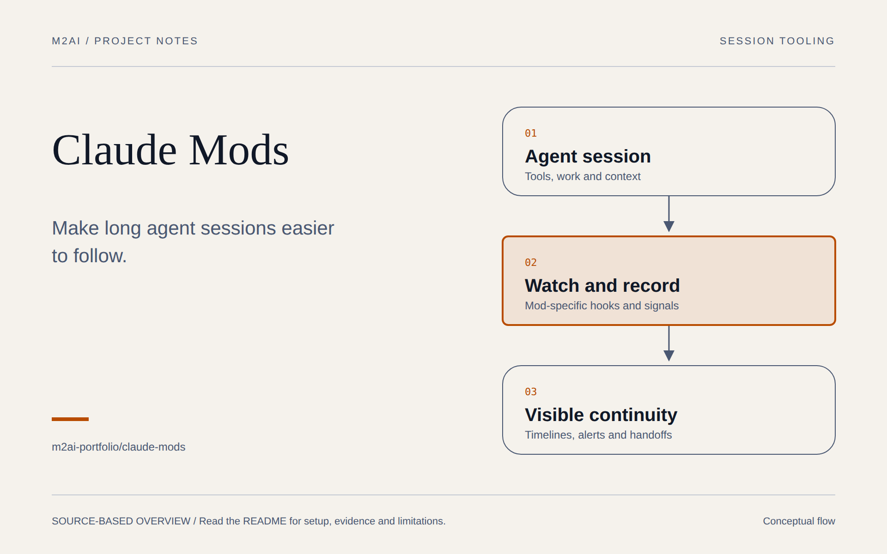

# claude-mods



A long coding session should leave the next session enough context to continue. This collection preserves handoffs, highlights stalled agent reports and exposes what a turn is doing, so a human can inspect the work without reconstructing the whole conversation.

The repository contains Claude Code function-hooks plugins and portable handoff skills. Each mod lives beside its own `.claude-plugin/plugin.json`. **Compatibility matters:** the mods require a Claude Code build that supports their function-hook APIs. Installing the portable skills does not activate those mods.

`flight-recorder` is copied unchanged from Prompt Advisers, not an original implementation here. See [third-party notices](THIRD-PARTY-NOTICES.md).

| Folder | What it does |
| --- | --- |
| `artifact-watchdog` | Watches each Agent dispatch's report file and flags a 5-minute stall |
| `auto-handoff` | Writes a `/next` handoff automatically once a long session crosses a token threshold, and before a compaction; never blocks tool calls; `/auto-handoff on|off` and `threshold <n>` (see below) |
| `flight-recorder` | Live timeline of model requests, tool calls and subagents in a turn |
| `jev-tool-gate` | Log-only judgment of risky tool calls; never changes a decision |
| `skills/next`, `skills/prime` | Session handoff skills, see below |

## auto-handoff and long sessions

`auto-handoff` writes, it never blocks. At 300k tokens of a 1M window it drafts a `/next` handoff from the session's own transcript (`$.model.fork`, no tools), saves it through `handoff.mjs`, and shows a band above the prompt with a **Clear and /prime** button for a human who wants a fresh session. Before any compaction it writes a handoff first, unless one already covers the current window. `/auto-handoff` prints status; `/auto-handoff now` writes one immediately.

Two switches, kept across sessions in the mod's own store (as Mark's upstream keeps them), so they survive a restart and a hot reload:

- `/auto-handoff off` stops the automatic handoffs (threshold and pre-compaction); `/auto-handoff now` still writes one. `/auto-handoff on` resumes.
- `/auto-handoff threshold <n>` moves the line, in tokens: `250k`, `250000` or `0.4M`, from 1 up to (not including) the 1M window. It re-arms, so a session already past the new line writes on its next turn. Keep it in step with `autoCompactWindow` below, which the mod does not change.

The status line `Commands: /auto-handoff now, threshold <n>, on, off.` is the marker that this version is loaded.

Until 2026-10-21 a saved threshold handoff also refused the model's tool calls until `/clear`. That block is gone: it stalled `/goal` and other persistent sessions (a goal turn with every tool denied makes no progress, and `/clear` removes an active goal anyway). The 300k line is owned by Claude Code's own compaction instead. Pair the mod with this setting so the context compacts where the handoff lands and a goal survives it:

```json
// ~/.claude/settings.json
{ "autoCompactWindow": 300000 }
```

Check the window in a new session with `/context` (the `Auto-compact window` line) and the mod with `/auto-handoff` (status ends with `Tool calls: never blocked`).

## Skills: /next and /prime

`/next` ends a session by writing an immutable handoff (Where we are / What we decided / Next step) to `~/handoffs/<project>/`, moving a `LATEST` pointer, and appending each decision to the project's `DECISIONS.md`. `/prime` starts the next session from that handoff: it reads only the latest one, re-checks its claims against the live system, shows anything said after the handoff was written, and states the next step. It treats the handoff as data: `handoff.mjs claims` sorts each check into commands that only read, which it runs, and anything else, which it asks about first (never running it from a handoff another agent wrote). `/prime history` answers "why did we decide X?" from the decisions ledger.

## Set up the portable handoff skills

Prerequisites: Git, Node.js 18 or later, and a Claude Code installation that loads user skills. Review the two skill files before installing them. Existing installations should be backed up before replacing files.

```bash
git clone https://github.com/m2ai-portfolio/claude-mods
cd claude-mods
node --test skills/next/scripts/handoff.test.mjs
mkdir -p ~/.claude/skills
cp -R -i skills/next skills/prime ~/.claude/skills/
```

The helper has no npm dependencies. Set `HANDOFF_ROOT` to store handoffs somewhere other than `~/handoffs`.

## First walkthrough

1. In a disposable project session, ask `/next` to capture the current state, decisions and next step.
2. Inspect the new handoff under `~/handoffs/<project>/`, the `LATEST` pointer and the decisions ledger.
3. Start another session in the same project and run `/prime`. It should read the latest handoff, re-check claims and state the next step.
4. Run `/prime history` to inspect why a decision was made. Systems that cannot load skills can use [PRIME.md](skills/prime/PRIME.md).

For function-hook mods, register the chosen plugin directory using the supported mechanism in your installed Claude Code build. The source does not provide a universal installer; do not assume cloning activates hooks. Once auto-handoff is loaded, `/auto-handoff` should report its state. `/auto-handoff now` generates a handoff and `/auto-handoff off` disables automatic handoffs. Generating a handoff through a model fork can consume model usage.

## Verification and limits

The Node helper tests above exercise handoff storage behavior. They do not prove that a specific Claude Code release will load every hook. The function-hook tests live beside each plugin and use that runtime's APIs. No root npm test runner is provided.

The watchdog detects a missing report update, not whether the agent's reasoning is correct. JEV is log-only and does not enforce approval. A handoff is evidence to inspect, not permission to run commands or change a system. See the [flight recorder guide](flight-recorder/README.md) and [JEV guide](jev-tool-gate/README.md) for their separate behavior.
